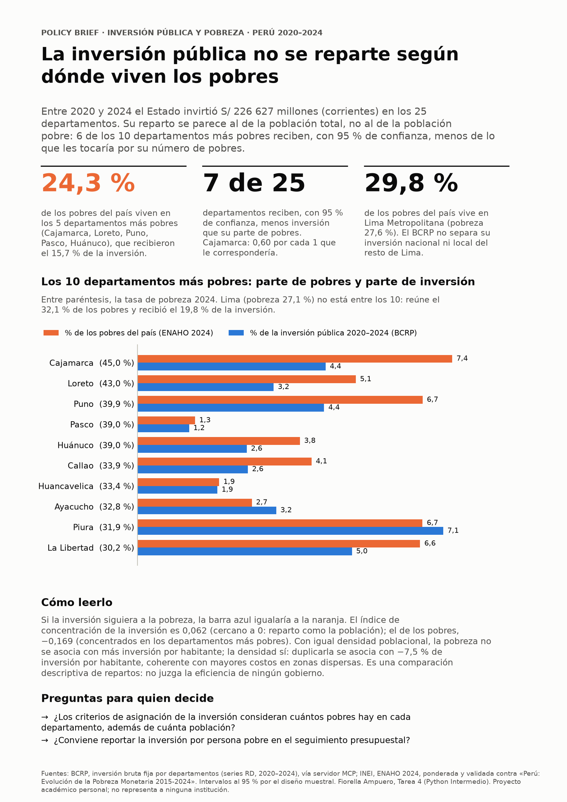

# ¿La inversión pública se reparte donde vive la población pobre? Perú, 2020–2024

Un agente de investigación con Claude Code que combina un **servidor MCP del BCRP** con **cinco Skills** para cruzar la inversión pública por departamento con la pobreza monetaria de la **ENAHO 2024**, y produce un informe y un policy brief con cifras verificables.

Autora: **Fiorella Ampuero**, con Claude Code. Curso Python Intermedio, Tarea 4 ([issue #201](https://github.com/d2cml-ai/Data-Science-Python/issues/201)). Proyecto académico personal; no representa a ninguna institución.

## Entregables (enlaces directos)

| Qué pide la tarea | Archivo definitivo |
|---|---|
| Informe final de investigación | [`informes/informe_final.md`](informes/informe_final.md) |
| Pruebas del servidor MCP: **10 passed** | [`evidencias_ia/mcp/pruebas.txt`](evidencias_ia/mcp/pruebas.txt) · código: [`mcp/server.py`](mcp/server.py), [`mcp/test_server.py`](mcp/test_server.py), [`mcp/test_cuadre.py`](mcp/test_cuadre.py) |
| Recurso y prompt del MCP usados desde Claude Code | [`evidencias_ia/mcp/03_prompt_y_recurso.md`](evidencias_ia/mcp/03_prompt_y_recurso.md) · capturas: [prompt (1)](evidencias_ia/mcp/mcp_03_prompt_informe_1.png), [prompt (2)](evidencias_ia/mcp/mcp_03_prompt_informe_2.png), [recurso](evidencias_ia/mcp/mcp_04_recurso_serie.png) |
| Validación de la ENAHO 2024 (27,58 %, 108 664 residentes, 25 departamentos) | [`salidas/validacion.txt`](salidas/validacion.txt) |
| Mapa con las 25 unidades y comparación con la sesión 16 | [`mapas/pobreza_departamento.png`](mapas/pobreza_departamento.png) · [`salidas/mapa_vs_referencia.csv`](salidas/mapa_vs_referencia.csv) |
| Indicadores del cruce BCRP + ENAHO | [`salidas/indicadores.csv`](salidas/indicadores.csv) · [`salidas/analisis.txt`](salidas/analisis.txt) |
| Evidencia de integración MCP + Skills (una sola sesión) | [`evidencias_ia/integracion/intento2_conversacion.md`](evidencias_ia/integracion/intento2_conversacion.md) · capturas en [`evidencias_ia/integracion/`](evidencias_ia/integracion/) |
| Preguntas de evaluación | [`evaluacion/preguntas.csv`](evaluacion/preguntas.csv) · robustez: [`evaluacion/robustez.csv`](evaluacion/robustez.csv) |
| Resultados de la evaluación | [`evaluacion/resultados.csv`](evaluacion/resultados.csv) · robustez: [`evaluacion/robustez_resultados.csv`](evaluacion/robustez_resultados.csv) |
| Comparación con y sin MCP/Skills | [`evaluacion/comparacion.md`](evaluacion/comparacion.md) |
| Verificación manual de 3 cifras | [Sección 8 del informe](informes/informe_final.md#8-verificación-manual-de-cifras) · capturas en [`evidencias_ia/verificacion/`](evidencias_ia/verificacion/) |
| Evidencias del uso de IA (conversaciones completas) | [Índice en la sección 12](#12-evidencias-del-uso-de-ia) |
| Extra: policy brief para decisores | [`informes/policy_brief.pdf`](informes/policy_brief.pdf) · [`informes/policy_brief.png`](informes/policy_brief.png) |



## 1. Objetivo

Responder con datos oficiales, y con un agente que use herramientas en lugar de su memoria: **entre 2020 y 2024, ¿la inversión pública se repartió entre los departamentos en proporción a dónde vive la población pobre?**

**Respuesta corta:** no. El reparto se parece al de la población total, no al de la población pobre. Los 5 departamentos más pobres tienen el 24,3 % de los pobres del país y recibieron el 15,7 % de la inversión; en 7 de 25 departamentos la inversión queda, con 95 % de confianza, por debajo de su parte de pobres. Es un análisis **descriptivo**: no mide si la inversión reduce la pobreza.

## 2. Arquitectura del agente

```text
           Pregunta en lenguaje natural
                       │
                 Claude Code ── plan de análisis
           ┌───────────┴────────────┐
   Servidor MCP bcrp            Skills (.claude/skills/)
   (mcp/server.py)              limpiando-enaho ──► graficando-enaho
   buscar_series · serie              │        └──► mapeando-enaho
   resumen · cuadre_territorial       ▼
           │                    analizando-reparto ──► redactando-brief
           ▼                          ▲
   salidas/bcrp_*.csv ────────────────┘
                       │
   informes/informe_final.md · informes/policy_brief.pdf
```

El MCP trae los datos del BCRP y los guarda con el código y la URL de cada serie; las skills procesan la ENAHO, validan contra el INEI, cruzan las dos fuentes y redactan. Cada cifra del informe se puede rastrear hasta un archivo de `salidas/` y, desde ahí, hasta su serie o microdato.

## 3. Herramientas MCP (`mcp/server.py`)

| Primitiva | Nombre | Qué hace |
|---|---|---|
| Herramienta | `buscar_series` | Encuentra el código de una serie del BCRP por palabras clave |
| Herramienta | `serie` | Datos de una serie entre dos fechas, con la URL de la fuente |
| Herramienta | `resumen` | Primero, último, variación, promedio, máximo y mínimo |
| Herramienta | `tasa_real` | Tasa de interés real y postura monetaria (del ejercicio de la sesión 04) |
| **Herramienta propia** | **`cuadre_territorial`** | Un indicador por departamento (inversión de los 3 niveles de gobierno, crédito, depósitos, exportaciones mineras) con la **llave ubigeo del INEI**; verifica que los 25 departamentos **sumen el total oficial** cada año, explica las diferencias (p. ej., la Municipalidad Metropolitana de Lima) y, si un año no existe, dice cuál es el último publicado en vez de rellenar. Con `guardar=True` escribe `salidas/bcrp_*.csv` |
| Recurso | `bcrp://serie/{codigo}` | Ficha descriptiva de una serie |
| Prompts | `postura_monetaria`, `informe` | Informes con cada cifra citada |

El recurso y el prompt `informe` se usaron desde Claude Code el 8-nov (`@bcrp:bcrp://serie/RD16682DA` y `/mcp__bcrp__informe`): [conversación](evidencias_ia/mcp/03_prompt_y_recurso.md) y capturas en [`evidencias_ia/mcp/`](evidencias_ia/mcp/). Claude Code separa los argumentos de un prompt por espacios, así que el prompt recibió solo `tema = «inversión»` (se ve en el texto exportado); el agente igual armó el informe por departamento con 12 llamadas al MCP.

**Pruebas:** `uv run pytest` → **10 passed**: las 8 originales de la sesión 04 (`mcp/test_server.py`, sin cambios) y 2 propias de `cuadre_territorial` (`mcp/test_cuadre.py`): el cuadre de la inversión regional 2024 con Lima Metropolitana y el aviso cuando un dato no existe.

## 4. Skills (`.claude/skills/`)

| Skill | Hace | Sale |
|---|---|---|
| `limpiando-enaho` | Lee los módulos 34 y 02 sin perder ceros en las llaves, filtra residentes habituales, une con `validate="m:1"` y valida (27,58 %, 108 664 residentes, 25 departamentos). Se detiene si una validación falla | `salidas/personas_2024.parquet`, `salidas/validacion.txt` |
| `graficando-enaho` | Pobreza ponderada por área, sexo, edad o **departamento** | `figuras/pobreza_*.png` |
| `mapeando-enaho` | Mapa coroplético uniendo `ubigeo[:2]` con `FIRST_IDDP`; 25 unidades, Lima y Callao separados; compara con la referencia de la sesión 16 | `mapas/pobreza_departamento.png`, `salidas/mapa_vs_referencia.csv` |
| `analizando-reparto` | Cruza la inversión del MCP con la ENAHO: participaciones, intervalos de confianza con el diseño muestral (validados contra el INEI), curva de concentración, densidad, minería y recuadro de Lima | `salidas/indicadores.csv`, `salidas/analisis.txt`, 4 figuras |
| `redactando-brief` | Policy brief de una página, con el método de [canvas-design](https://github.com/anthropics/skills/tree/main/skills/canvas-design) adaptado a datos (`filosofia.md`) | `informes/policy_brief.png`, `.pdf` |

Las skills de gráficos, mapas y análisis indican usar primero `limpiando-enaho` si falta la base limpia. En la ejecución integrada se vio así: el agente comprobó que faltaba `personas_2024.parquet`, invocó la limpieza y siguió.

## 5. Fuentes y descarga de datos

| Fuente | Enlace | Dónde va |
|---|---|---|
| ENAHO 2024, módulo 34 (sumaria) | [966-Modulo34.zip](https://proyectos.inei.gob.pe/iinei/srienaho/descarga/STATA/966-Modulo34.zip) | `datos/` sin descomprimir |
| ENAHO 2024, módulo 02 (miembros) | [966-Modulo02.zip](https://proyectos.inei.gob.pe/iinei/srienaho/descarga/STATA/966-Modulo02.zip) | `datos/` sin descomprimir |
| Límites departamentales | [peru_departamental_simple.geojson](https://raw.githubusercontent.com/d2cml-ai/Data-Science-Python/main/sessions/06-geoespacial/lab/Data/peru_departamental_simple.geojson) | `datos/` |
| Series del BCRP | [BCRPData](https://estadisticas.bcrp.gob.pe/estadisticas/series/) | El MCP las descarga solo (el catálogo, ~7 MB, se guarda en `datos/` la primera vez) |
| Cifras oficiales para validar | INEI, [*Perú: Evolución de la Pobreza Monetaria, 2015-2024*](https://www.gob.pe/institucion/inei/informes-publicaciones/6763186-peru-evolucion-de-la-pobreza-monetaria-2015-2024), anexo p. 220 | `.claude/skills/analizando-reparto/referencias/inei_pobreza_2024.csv` |

`datos/` está en `.gitignore`: los microdatos no se suben.

## 6. Instalación

Requiere [uv](https://docs.astral.sh/uv/) y [Claude Code](https://code.claude.com/docs).

```bash
git clone <este repositorio> && cd Tarea_4
uv sync                 # Python 3.14 y dependencias (fastmcp, pandas, pyarrow, geopandas, matplotlib, pytest)
# descargar los 3 archivos de la sección 5 en datos/
```

## 7. Conectar el MCP a Claude Code

El servidor ya está declarado en [`.mcp.json`](.mcp.json) (`uv run mcp/server.py`). Al abrir `claude` en la carpeta, aceptar **«Use this MCP server»**; con `/mcp` debe aparecer `bcrp` como *connected*.

## 8. Reproducir el procesamiento y las pruebas

```bash
uv run pytest                                                        # 10 passed
uv run .claude/skills/limpiando-enaho/scripts/limpiar.py --anio 2024  # RESULTADO: APROBADO
uv run .claude/skills/graficando-enaho/scripts/graficar.py --por departamento
uv run .claude/skills/mapeando-enaho/scripts/mapear.py
# Datos del BCRP: desde Claude Code, cuadre_territorial(..., guardar=True) para los 3 niveles de inversión
# 2020–2024 y exportaciones_mineras 2018–2022 (ver informes/informe_final.md, sección 7)
uv run .claude/skills/analizando-reparto/scripts/analizar.py
uv run .claude/skills/redactando-brief/scripts/brief.py
uv run evaluacion/evaluar.py && uv run evaluacion/calificar.py       # evaluación A/B (≈ 10 min)
```

**Reproducibilidad comprobada:** en la ejecución integrada se borraron todas las salidas y el agente las regeneró desde cero; los archivos de `salidas/` quedaron idénticos byte a byte a los versionados.

## 9. Resultados de la evaluación

Las mismas 10 preguntas (4 BCRP, 4 ENAHO, 2 combinadas), con respuestas esperadas verificadas en fuentes oficiales y registradas en git **antes** de correr, en sesiones independientes de Claude Code (Sonnet):

| | Sin MCP ni Skills (A) | Con MCP y Skills (B) |
|---|---|---|
| Respuestas correctas | **10/10** | **10/10** |
| Tiempo promedio | 29,0 s | 34,7 s |
| Pruebas de robustez (datos inexistentes, ambigüedad, distrito, causalidad) | 5/5 | 5/5 |

El modo A también acertó porque, con Bash y los datos crudos, Sonnet consultó la API del BCRP con `curl` y procesó los microdatos por su cuenta. La diferencia no estuvo en la exactitud sino en la **trazabilidad, la consistencia y la validación** de cada cifra. Análisis completo en [`evaluacion/comparacion.md`](evaluacion/comparacion.md); datos en [`evaluacion/resultados.csv`](evaluacion/resultados.csv) y [`evaluacion/robustez_resultados.csv`](evaluacion/robustez_resultados.csv).

## 10. Limitaciones y problemas encontrados

- **Descriptivo:** compara repartos con una sola medición de pobreza (2024); no estima efectos de la inversión.
- **Ubicación ≠ beneficiarios:** el BCRP asigna la inversión al departamento donde se ejecuta; soles corrientes, sin deflactar.
- **Lima:** el BCRP no separa Lima Metropolitana en la inversión nacional ni local; se trata Lima como un departamento y un recuadro separa lo que la fuente permite.
- **Conteos:** la base pública no reproduce el total de pobres ajustado del INEI (9 395 mil); por eso se usan participaciones, que sí coinciden.
- **Exportaciones mineras:** por departamento llegan solo a 2022 y no cuadran del todo con el total oficial (hasta 101,95 millones de US$); se usan solo como complemento.
- **Problemas del desarrollo:** el MCP no alcanzaba a conectar en copias limpias (se resolvió reutilizando el entorno); en la primera ejecución integrada el agente corrió los scripts de las skills por Bash en vez de invocarlas (se repitió con instrucción explícita); en la evaluación, las skills no se activaron en 2 de 6 preguntas de la ENAHO.

## 11. Ejemplo de una ejecución completa

Pedido usado en Claude Code (intento 2):

> Pregunta de investigación: entre 2020 y 2024, ¿la inversión pública se repartió entre los departamentos del Perú en proporción a dónde vive la población pobre? … Procesa la ENAHO 2024 y analiza el cruce invocando las skills del proyecto con la herramienta Skill …

En esa sola sesión el agente hizo **9 llamadas al MCP** (`cuadre_territorial` ×4, `buscar_series`, `resumen` ×4) e **invocó 4 skills** (`limpiando-enaho`, `graficando-enaho`, `mapeando-enaho`, `analizando-reparto`), y escribió [`informes/informe_final.md`](informes/informe_final.md). Capturas paso a paso en [`evidencias_ia/integracion/`](evidencias_ia/integracion/).

## 12. Evidencias del uso de IA

El desarrollo se hizo con Claude Code. Las conversaciones completas están exportadas a Markdown con [`evidencias_ia/exportar_conversaciones.py`](evidencias_ia/exportar_conversaciones.py), que reemplaza el correo y el usuario de Windows de la autora, omite los recordatorios internos del sistema y verifica que no quede ningún dato personal. En 4 capturas se tapó el usuario de Windows.

| Etapa | Conversación |
|---|---|
| Conversación principal de la Tarea 4: plan, herramienta propia del MCP, skills nuevas, análisis, evaluación, informe y brief (3 al 7-nov) | [`evidencias_ia/00_conversacion_principal_tarea4.md`](evidencias_ia/00_conversacion_principal_tarea4.md) |
| Desarrollo del servidor MCP del BCRP (sesión 04, 28-oct) | [`evidencias_ia/mcp/01_desarrollo_mcp_bcrp_sesion04.md`](evidencias_ia/mcp/01_desarrollo_mcp_bcrp_sesion04.md) |
| Prueba del MCP desde Claude Code (28-oct) | [`evidencias_ia/mcp/02_prueba_mcp_en_claude_code.md`](evidencias_ia/mcp/02_prueba_mcp_en_claude_code.md) |
| Prompt `/mcp__bcrp__informe` y recurso `@bcrp:bcrp://serie/RD16682DA` desde Claude Code (8-nov) | [`evidencias_ia/mcp/03_prompt_y_recurso.md`](evidencias_ia/mcp/03_prompt_y_recurso.md) · [capturas](evidencias_ia/mcp/) |
| Desarrollo de las skills de la ENAHO (sesión 16, 31-oct) | [`evidencias_ia/skills/01_desarrollo_skills_enaho_sesion16.md`](evidencias_ia/skills/01_desarrollo_skills_enaho_sesion16.md) |
| Ejecución integrada, intento 1 (skills corridas por Bash) | [`evidencias_ia/integracion/intento1_conversacion.md`](evidencias_ia/integracion/intento1_conversacion.md) · [informe de ese intento](evidencias_ia/integracion/intento1_informe_final.md) |
| Ejecución integrada, intento 2 (4 skills + 9 llamadas al MCP) | [`evidencias_ia/integracion/intento2_conversacion.md`](evidencias_ia/integracion/intento2_conversacion.md) |
| Sesiones de evaluación, legibles (cada pregunta, sus herramientas y su respuesta) | [Modo A](evidencias_ia/evaluacion/modo_A_sin_mcp_ni_skills.md) · [Modo B](evidencias_ia/evaluacion/modo_B_con_mcp_y_skills.md) · [Intento «solo memoria»](evidencias_ia/evaluacion/modo_M_solo_memoria_intento_fallido.md) · registros en bruto en [`evaluacion/logs/`](evaluacion/logs/) |
| Capturas de la ejecución integrada y de la verificación manual | [`evidencias_ia/integracion/`](evidencias_ia/integracion/) · [`evidencias_ia/verificacion/`](evidencias_ia/verificacion/) |

## Estructura

```text
Tarea_4/
├── README.md · pyproject.toml · uv.lock · .mcp.json · .gitignore
├── mcp/                server.py, test_server.py (8 originales), test_cuadre.py (2 propias)
├── .claude/skills/     limpiando-enaho, graficando-enaho, mapeando-enaho, analizando-reparto, redactando-brief
├── datos/              microdatos y GeoJSON (no se suben)
├── salidas/            validacion.txt, indicadores.csv, analisis.txt, bcrp_*.csv, …
├── figuras/ · mapas/
├── informes/           informe_final.md, policy_brief.png/.pdf
├── analisis/           borradores de exploración de los primeros días (no forman parte del flujo final; ver su README)
├── evaluacion/         preguntas.csv, robustez.csv, evaluar.py, calificar*.py, resultados.csv, comparacion.md, logs/
└── evidencias_ia/      mcp/, skills/, integracion/, evaluacion/, verificacion/
```
