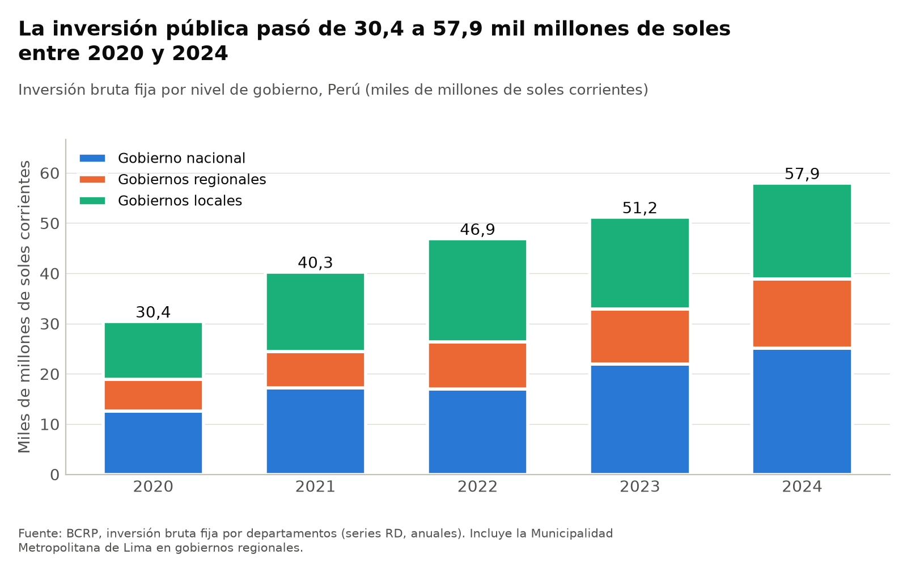
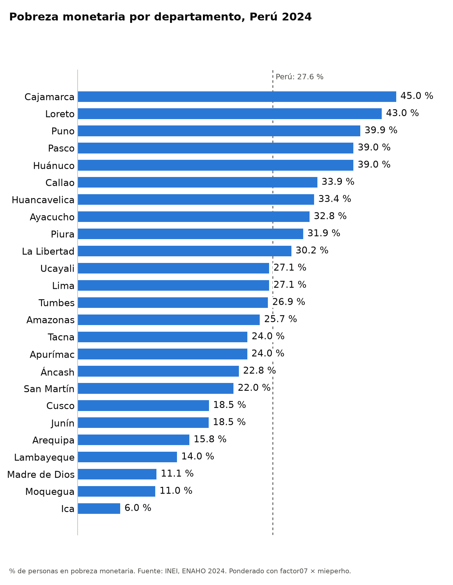
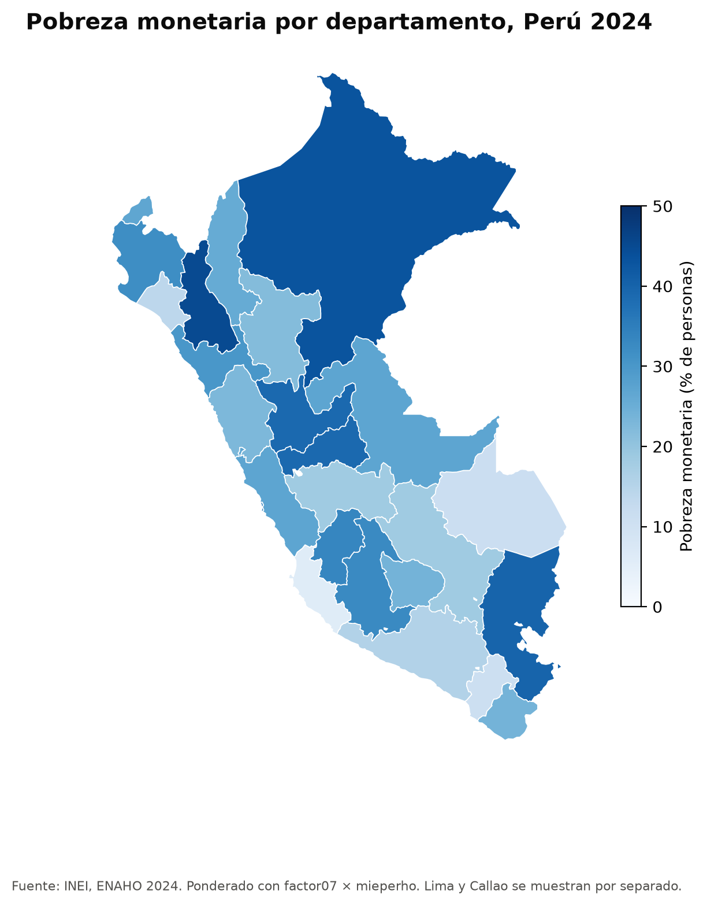
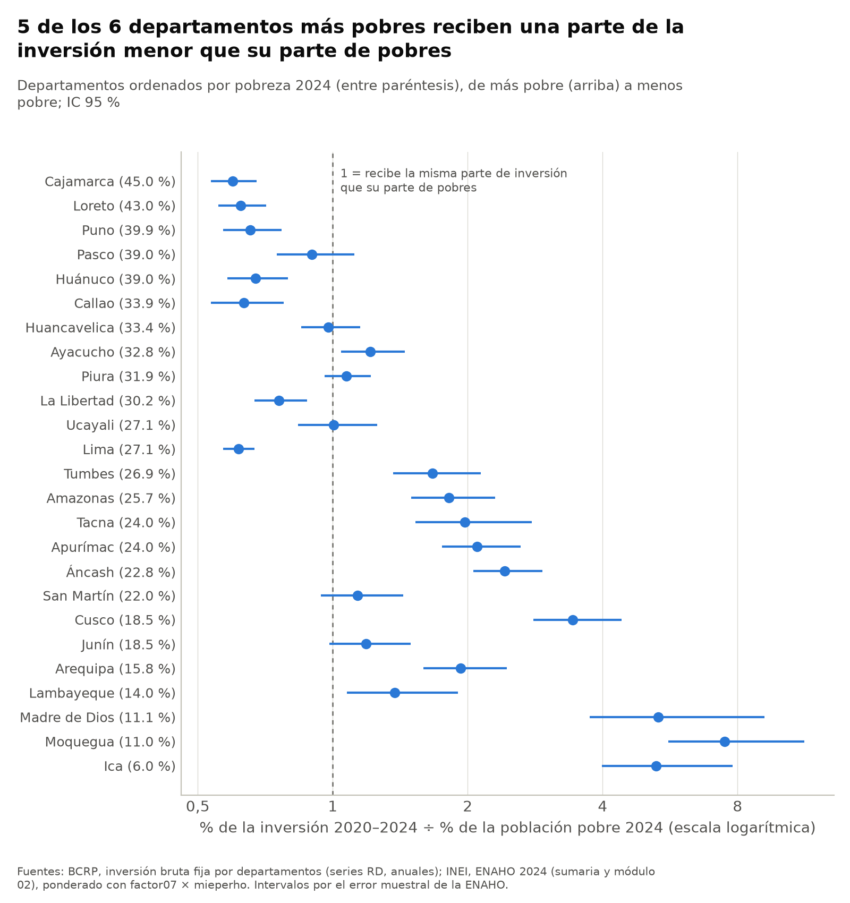
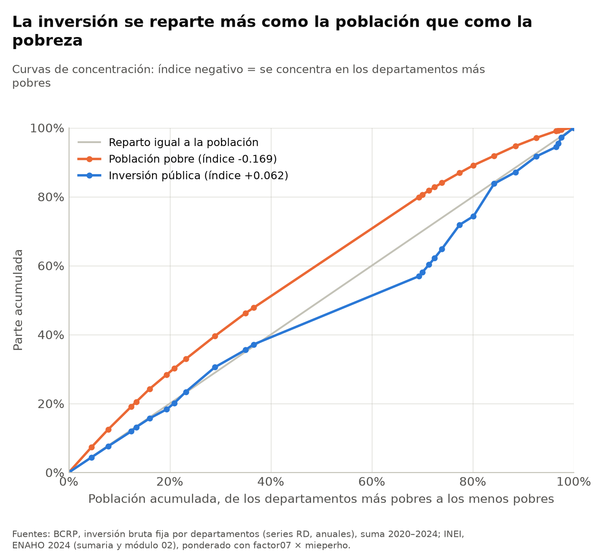

# ¿La inversión pública 2020–2024 se repartió donde vive la población pobre?

Informe final · Tarea 4, Python Intermedio · Autora: Fiorella Ampuero · Elaborado con Claude Code (servidor MCP `bcrp` y skills del proyecto)

---

## 1. Pregunta y delimitación

**Pregunta.** Entre 2020 y 2024, ¿la inversión pública se repartió entre los departamentos del Perú en proporción a dónde vive la población pobre?

**Delimitación.**

- **Unidad:** los 25 departamentos que publica el BCRP. Lima y Callao van por separado y Lima se trata como un solo departamento. El recuadro de la sección 4.4 separa Lima Metropolitana de Lima provincias solo donde la fuente lo permite.
- **Inversión:** inversión bruta fija de los tres niveles de gobierno (nacional, regionales y locales), sumada de 2020 a 2024 en millones de soles corrientes.
- **Pobreza:** pobreza monetaria 2024 de la ENAHO del INEI. Es el único año de la ENAHO procesado y validado en este proyecto.
- **Criterio de proporcionalidad:** se compara la *parte* de la inversión nacional que recibe cada departamento con su *parte* de la población pobre del país. El cociente inversión/pobres vale 1 cuando el reparto es proporcional.
- **Alcance:** el análisis es descriptivo. Compara repartos y **no** estima si la inversión causa o reduce la pobreza, ni juzga la eficiencia de ningún gobierno.

## 2. Fuentes y metodología

### 2.1 Fuentes

| Fuente | Contenido | Series o archivo |
|---|---|---|
| BCRP, inversión bruta fija del gobierno nacional por departamento | Anual, 2020–2024 | RD16657DA–RD16681DA (departamentos), RD16682DA (total) → `salidas/bcrp_inversion_gobierno_nacional_2020_2024.csv` |
| BCRP, inversión bruta fija de los gobiernos regionales | Anual, 2020–2024 | RD16709DA–RD16733DA (departamentos), RD16734DA (Municipalidad Metropolitana de Lima), RD16735DA (total) → `salidas/bcrp_inversion_gobiernos_regionales_2020_2024.csv` |
| BCRP, inversión bruta fija de los gobiernos locales | Anual, 2020–2024 | RD16683DA–RD16707DA (departamentos), RD16708DA (total) → `salidas/bcrp_inversion_gobiernos_locales_2020_2024.csv` |
| BCRP, exportaciones mineras por departamento | Anual, 2018–2022 (el BCRP publica la serie por departamento solo hasta 2022) | RD40961BA–RD41369BA, RD41386BA (sin ubigeo), PM40047BA (total) → `salidas/bcrp_exportaciones_mineras_2018_2022.csv` |
| INEI, ENAHO 2024, módulos 34 (sumaria) y 02 (miembros del hogar) | Microdatos | `datos/966-Modulo34.zip`, `datos/966-Modulo02.zip` → `salidas/personas_2024.parquet` |
| INEI, *Perú: Evolución de la Pobreza Monetaria 2015-2024*, anexo p. 220 | Cifras oficiales para validar | `.claude/skills/analizando-reparto/referencias/inei_pobreza_2024.csv` |
| Límites departamentales | GeoJSON | `datos/peru_departamental_simple.geojson` |

### 2.2 Procedimiento

1. **Datos del BCRP.** Se consultaron con la herramienta `cuadre_territorial` del servidor MCP `bcrp`, con `guardar=True`. La herramienta trae los 25 departamentos con su ubigeo y verifica que sumen el total oficial cada año. La evolución nacional se describió con la herramienta `resumen`.
2. **Limpieza de la ENAHO** (skill `limpiando-enaho`). Se unieron la sumaria y el módulo 02, se dejaron solo los residentes habituales y se validó contra la cifra oficial. El resultado fue **APROBADO** en las 12 pruebas (`salidas/validacion.txt`).
3. **Gráfico de pobreza por departamento** (skill `graficando-enaho`). Ponderado con `factor07 × mieperho` sobre hogares únicos.
4. **Mapa** (skill `mapeando-enaho`). La unión se hizo por código de ubigeo y no por nombre, y cada departamento se validó contra la referencia del curso (`salidas/mapa_vs_referencia.csv`).
5. **Cruce** (skill `analizando-reparto`). Combina las participaciones de inversión con las participaciones de pobres. Los intervalos de confianza de la ENAHO usan el diseño muestral: conglomerados (`conglome`) dentro de estratos departamento × estrato, con linealización. A partir de ahí calcula las curvas e índices de concentración, una regresión descriptiva de la inversión por habitante sobre pobreza y log(densidad) con errores estándar robustos, y una correlación de Spearman con la minería. Las salidas son `salidas/indicadores.csv`, `salidas/recuadro_lima.csv` y `salidas/analisis.txt`.

**Por qué participaciones y no conteos.** El INEI ajusta los conteos absolutos de pobres a proyecciones de población (9 395 mil pobres), mientras que la base pública da otro total. Las tasas y las participaciones sí coinciden con las oficiales, así que el análisis compara partes.

## 3. Contexto: evolución de la inversión pública 2020–2024

- La inversión del **gobierno nacional** pasó de 12 545.7 millones de soles en 2020 a 25 109.3 millones en 2024, un aumento de **100.14 %**, con un promedio de 18 753.1 millones por año. El mínimo fue en 2020 y el máximo en 2024 (herramienta `resumen`, serie **RD16682DA**).
- Los **gobiernos regionales** pasaron de 6 366.5 a 13 717.4 millones (+115.46 %, **RD16735DA**). Los **gobiernos locales** pasaron de 11 489.5 a 19 118.3 millones (+66.4 %), con su máximo en 2022, cuando invirtieron 20 499.8 millones (**RD16708DA**).
- Sumando los tres niveles, la inversión fue de **30 402 millones de soles en 2020 y 57 945 millones en 2024**, y el acumulado 2020–2024 llegó a **226 627 millones** de soles corrientes (`salidas/analisis.txt`).

*Figura 1. Inversión bruta fija por nivel de gobierno. Fuente: BCRP, series RD por departamento (`figuras/bcrp_inversion_anual.png`).*

## 4. Hallazgos

### 4.1 Hallazgo 1: los departamentos más pobres reciben una parte de la inversión menor que su parte de pobres

La pobreza monetaria nacional en 2024 fue de **27.6 %** (INEI, ENAHO 2024, `salidas/validacion.txt`). Por departamento va desde **45.0 % en Cajamarca** hasta **6.0 % en Ica**, en ambos casos ponderada con `factor07 × mieperho` (`figuras/pobreza_departamento.png`).

*Figura 2. Pobreza monetaria por departamento, 2024. Fuente: INEI, ENAHO 2024 (`figuras/pobreza_departamento.png`).*

*Figura 3. Mapa coroplético de la pobreza monetaria, 2024. Fuente: INEI, ENAHO 2024 (`mapas/pobreza_departamento.png`). Los 25 departamentos tienen dato y la diferencia máxima con la referencia del curso es de 0.05 puntos.*

Al cruzar con la inversión 2020–2024 (`salidas/indicadores.csv`, `salidas/analisis.txt`):

- Los **5 departamentos más pobres** (Cajamarca, Loreto, Puno, Pasco y Huánuco) concentran el **24.3 % de los pobres** del país y el **16.0 % de la población**, pero recibieron el **15.7 % de la inversión**. En otras palabras, su parte de la inversión se parece a su parte de la población y no a su parte de pobres.
- En **7 departamentos** el intervalo de confianza al 95 % del cociente inversión/pobres queda entero por debajo de 1, es decir, recibieron menos que su parte de pobres: Cajamarca (0.60 [0.54–0.68]), Lima (0.62 [0.57–0.67]), Loreto (0.62 [0.56–0.71]), Callao (0.63 [0.53–0.78]), Puno (0.65 [0.57–0.77]), Huánuco (0.67 [0.58–0.79]) y La Libertad (0.76 [0.67–0.88]).
- En el otro extremo, varios departamentos de baja pobreza reciben varias veces su parte de pobres: Moquegua (pobreza 11.0 %, cociente 7.50 [5.61–11.28]), Madre de Dios (11.1 %, 5.32 [3.74–9.20]), Ica (6.0 %, 5.27 [3.98–7.80]) y Cusco (18.5 %, 3.43 [2.81–4.41]). El caso de Cusco pesa por los gobiernos locales, que concentran el 14.77 % de la inversión local del país.
- **Lima** reúne el **32.11 %** de los pobres del país [29.54–34.67] y recibió el **19.77 %** de la inversión total. Por nivel, Lima concentra el 37.53 % de la inversión del gobierno nacional, pero solo el 4.13 % de la regional y el 8.96 % de la local.

*Figura 4. Parte de la inversión 2020–2024 dividida entre la parte de la población pobre 2024, con IC 95 % por el error muestral de la ENAHO. Fuentes: BCRP (series RD), INEI, ENAHO 2024 (`figuras/inversion_vs_pobres.png`).*

### 4.2 Hallazgo 2: la inversión se reparte de forma casi neutra frente a la pobreza, mientras que la población pobre está concentrada

Los departamentos se ordenan de mayor a menor pobreza. Un índice de concentración negativo indica que la variable se concentra en los departamentos más pobres (`salidas/analisis.txt`):

| Variable | Índice de concentración |
|---|---|
| Población pobre | **−0.169** |
| Inversión total | **+0.062** |
| Gobierno nacional | +0.027 |
| Gobiernos regionales | +0.026 |
| Gobiernos locales | +0.120 |

La población pobre está concentrada en los departamentos de mayor pobreza (índice negativo). La inversión no lo está: su índice es ligeramente positivo y su curva se mantiene cerca de la diagonal de reparto igual a la población, con un tramo por debajo de ella a la altura de Lima. De los tres niveles, el de gobiernos locales es el que más se aleja de los departamentos pobres (+0.120).

*Figura 5. Curvas de concentración de la inversión pública 2020–2024 y de la población pobre 2024. Fuentes: BCRP (series RD), INEI, ENAHO 2024 (`figuras/curva_concentracion.png`).*

### 4.3 Hallazgo 3: con igual densidad, la inversión por habitante no sube con la pobreza

En una regresión descriptiva con los 25 departamentos, se explica el log de la inversión por habitante con la pobreza y con el log de la densidad (`salidas/analisis.txt`, `figuras/densidad_inversion.png`):

- **Pobreza:** −0.0118 por punto (EE robusto 0.0066; IC 95 % de −0.0247 a +0.0012). A igual densidad, cada punto adicional de pobreza se asocia con alrededor de **−1.2 %** de inversión por habitante, aunque el intervalo incluye el cero. Lo que sí se puede afirmar es que **no hay evidencia de que la inversión por habitante aumente con la pobreza**.
- **Densidad:** el coeficiente de log(densidad) es −0.1118 (IC 95 % de −0.1929 a −0.0307). Duplicar la densidad se asocia con alrededor de **−7.5 %** de inversión por habitante. R² = 0.31.

**Complemento minero.** La correlación de Spearman entre el cociente inversión/pobres y la parte de las exportaciones mineras 2018–2022 es de **0.20** con 25 departamentos (`salidas/analisis.txt`, series RD40961BA–RD41369BA). La asociación es débil. Aun así, varios departamentos con cocientes altos, como Moquegua, Áncash y Arequipa, tienen partes de exportación minera altas: 8.49 %, 13.00 % y 14.61 % respectivamente (`salidas/indicadores.csv`). Esto es una coincidencia descriptiva y no prueba ningún mecanismo, como el canon.

### 4.4 Recuadro: Lima Metropolitana y Lima provincias

Fuente: `salidas/recuadro_lima.csv`, con la inversión regional de las series RD16732DA y RD16734DA.

| Ámbito | Pobreza 2024 [IC 95 %] | % de pobres del país | Inversión regional 2020–2024 (millones de soles) |
|---|---|---|---|
| Lima Metropolitana (provincia de Lima) | 27.6 % [25.0–30.1] | 29.8 % | 455 |
| Lima provincias (región Lima) | 21.7 % [18.3–25.1] | 2.3 % | 1 516 |

Lima Metropolitana concentra casi tres de cada diez pobres del país. Sin embargo, solo se puede comparar la inversión **regional**, porque el BCRP no separa entre ambos ámbitos la inversión del gobierno nacional ni la de los gobiernos locales en Lima.

## 5. Interpretación

La respuesta a la pregunta es **no**: entre 2020 y 2024 la inversión pública no se repartió en proporción a la población pobre. Su reparto se parece más al de la población total (Figura 5 y cocientes inversión/población de `salidas/indicadores.csv`). Como la pobreza está concentrada en algunos departamentos, un reparto por población deja a los más pobres por debajo de su parte de pobres. Así ocurre en Cajamarca, Loreto, Puno y Huánuco, y también en Lima y Callao por su gran número absoluto de pobres. En cambio, departamentos poco poblados y de baja pobreza, como Moquegua, Madre de Dios e Ica, reciben varias veces su parte.

Esto describe *cómo* se repartió la inversión, no *por qué* ni con qué efecto. El reparto puede reflejar criterios legítimos que este análisis no observa: costos de construcción, proyectos de alcance nacional ubicados en un departamento, reglas de transferencias como el canon y la capacidad de ejecución, entre otros. Tampoco se puede concluir que la inversión haya cambiado la pobreza, porque la pobreza se mide en un solo año (2024) y no se estima ningún efecto.

## 6. Limitaciones

1. **Desfase temporal.** La inversión es un acumulado 2020–2024 y la pobreza corresponde solo a 2024. El reparto de pobres pudo ser distinto en los primeros años del periodo.
2. **Ubicación ≠ beneficiarios.** El BCRP asigna la inversión al departamento donde se ejecuta. Una obra nacional en Lima o Callao, como un puerto, un aeropuerto o una sede de ministerio, puede beneficiar a todo el país.
3. **Soles corrientes.** Los montos no están deflactados y los costos de construcción difieren entre departamentos.
4. **Lima como un solo departamento.** El BCRP no separa Lima Metropolitana de Lima provincias en la inversión nacional ni en la local (sección 4.4). La inversión de la Municipalidad Metropolitana de Lima (RD16734DA) se asignó a Lima en los gobiernos regionales.
5. **Error muestral.** Las participaciones de pobres son estimaciones. Por eso se reportan intervalos al 95 %, y los departamentos pequeños, como Madre de Dios, Moquegua y Tacna, tienen intervalos anchos.
6. **Exportaciones mineras: el cuadre no cierra en todos los años.** En la herramienta `cuadre_territorial` los departamentos más la serie «sin ubigeo» (RD41386BA) no suman exactamente el total oficial (PM40047BA). La diferencia sin explicar es de 5.74 millones de US$ en 2018, 14.48 en 2019, −4.01 en 2020, −0.40 en 2021 y **101.95 en 2022**, y solo 2021 aparece como cuadrado. Además, la serie departamental se actualizó por última vez el 2024-12-20 y llega solo hasta 2022. La minería se usa solo como complemento descriptivo (Spearman 0.20) y no en los hallazgos principales. Las tres series de inversión sí cuadran todos los años.
7. **Regresión con 25 observaciones.** La regresión del hallazgo 3 es descriptiva, tiene poca potencia y el coeficiente de pobreza no es estadísticamente distinto de cero.
8. **Conteos absolutos.** No se reportan números de pobres porque la base pública no reproduce el total ajustado del INEI (sección 2.2).

**Fallas de herramientas.** Ninguna herramienta falló. Todas las llamadas al MCP `bcrp` devolvieron datos para los 25 departamentos sin años faltantes, y las cuatro skills terminaron con sus validaciones aprobadas. La única irregularidad de datos es la del punto 6.

## 7. Reproducibilidad

Requisitos: `uv` y los microdatos de la ENAHO 2024 en `datos/`, descargados del INEI como indica `README.md`. Todos los comandos se corren desde la raíz de `Tarea_4`.

1. **Entorno:** `uv sync`. El servidor MCP está declarado en `.mcp.json` (`uv run mcp/server.py`).
2. **BCRP:** desde Claude Code, con el servidor `bcrp`:
   - `cuadre_territorial("inversion_gobierno_nacional", "2020", "2024", guardar=True)`
   - `cuadre_territorial("inversion_gobiernos_regionales", "2020", "2024", guardar=True)`
   - `cuadre_territorial("inversion_gobiernos_locales", "2020", "2024", guardar=True)`
   - `cuadre_territorial("exportaciones_mineras", "2018", "2022", guardar=True)`
   - `resumen("RD16682DA", "2020", "2024")`, y también RD16735DA y RD16708DA para los otros niveles
3. **ENAHO y cruce:** se invocan las skills en este orden, y cada una corre su script:
   - `limpiando-enaho` → `.claude/skills/limpiando-enaho/scripts/limpiar.py --anio 2024`
   - `graficando-enaho` → `.claude/skills/graficando-enaho/scripts/graficar.py --por departamento`
   - `mapeando-enaho` → `.claude/skills/mapeando-enaho/scripts/mapear.py`
   - `analizando-reparto` → `.claude/skills/analizando-reparto/scripts/analizar.py`
4. **Salidas esperadas:** `salidas/validacion.txt` (con «RESULTADO: APROBADO»), `salidas/indicadores.csv`, `salidas/analisis.txt`, `salidas/recuadro_lima.csv`, `salidas/mapa_vs_referencia.csv`, `figuras/*.png` y `mapas/pobreza_departamento.png`.

Fecha de consulta de los datos del BCRP: 2026-11-06. Según la herramienta, las series de inversión se actualizaron el 2026-04-30.
